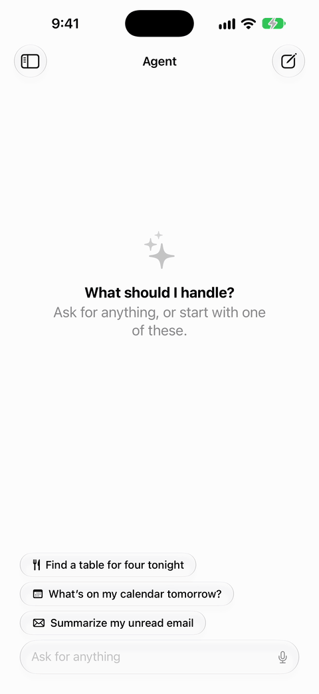

# Agent chats

[Swift Chat](../README.md) › Agent chats

```swift
Chat(thread.messages, typingUsers: thread.working ? [agent] : []) { message in
    if let result = message.result {
        Message(message.text, role: message.role, timestamp: message.sentAt)
            .messageAttachment { ResultCard(result) }
    } else if message.isSuggestion {
        Message(message.text, role: .me, timestamp: message.sentAt)
            .messageStyle(.suggestion)
    } else {
        Message(message.text, role: message.role, timestamp: message.sentAt)
    }
}
.chatStyle(.assistant)
.chatTypingStatus(thread.status)
.chatInputSuggestions(thread.messages.isEmpty ? thread.openers : [])
.onChatSend { text, media in
    await thread.send(text, media)
}
```

A thread with an agent needs things a thread between two people does not: a reply that arrives while it is still being written, a line saying which step the agent is on, results that are more than text, things to tap instead of type, and a rule for whose turn it is. Each one is a modifier or a small type. That screen is the whole UI of an agent that searches, holds a table, and offers to book it.



Swift Chat has no model, network, or agent loop inside it. You run the agent; these are the pieces that draw it.

## Two shapes

| | `.chatStyle(.assistant)` | `.chatStyle(.messages)` |
|---|---|---|
| Reads like | Siri, ChatGPT | Messages |
| Replies | Bare Markdown across the full width, streamed word by word | Bubbles that land a line at a time |
| While it works | A ring spinner with a status line beside it | Typing dots, with the step in the header’s subtitle |
| Fits | Research, long answers, work with many steps | A coach, a companion, a concierge you text |

Everything below works in both. [Assistant style](assistant-style.md) covers the first layout in full.

## Stream the reply

Append one message for the reply and rewrite its text as tokens arrive. The row grows in place, each new word fades in, and nothing above it moves.

```swift
func answer(_ prompt: String) async throws {
    let reply = ThreadMessage(text: "", role: agent)
    messages.append(reply)
    for try await token in model.stream(prompt) {
        guard let index = messages.firstIndex(where: { $0.id == reply.id }) else { return }
        messages[index].text += token
    }
}
```

Reply text is Markdown in the assistant style: headings, lists, bold and italic, links, block quotes, code blocks, and rules. Keep the message’s `id` the same for the whole stream.

## Say which step it is on

Show the agent’s typing indicator while it works and hand `chatTypingStatus(_:)` a line for the step. A new line rolls the old one up and out, so a run of tool calls reads as “Checking your calendar”, “Searching restaurants nearby”, “Comparing 14 places”.

```swift
for try await event in agent.run(prompt) {
    switch event {
    case .toolStarted(let tool): status = tool.label
    case .token(let token): status = nil; append(token)
    case .toolFinished(let result): attach(result)
    }
}
```

Pass `nil` for the indicator alone. In the messages style the indicator is the typing dots and the line goes in the header: `ChatHeader(title: "Coach", subtitle: thread.status)`. See [Headers](headers.md).

## Show results as views

A tool result is rarely a sentence. `messageAttachment { }` puts any SwiftUI view in the thread as a message: a reservation, a chart, a diff, a form with its own buttons. In the assistant style it is drawn bare at the full width, so the card you design is the card the reader sees; in the messages style it sits where a photo would.

```swift
Message("", role: agent, timestamp: step.finishedAt)
    .messageAttachment {
        ReservationCard(step.reservation) {
            thread.confirm(step.reservation)
        }
    }
```

Controls inside the view are live. A photo the agent returns goes through `messageMedia(_:)` instead: it runs the full width of the thread and opens full screen on a tap.

## Offer the next message

There are two kinds of suggestion. A tap on either sends a whole message the way the send button does: the bubble leaves from where the suggestion stood, travels to its place in the thread, and the words arrive in `onChatSend` with no media.

**Above the input bar.** `chatInputSuggestions(_:)` stacks chips over the field while nothing is typed, each with an optional symbol. They suit an empty thread.

```swift
.chatInputSuggestions([
    ChatInputSuggestion(text: "Find a table for four tonight", systemImage: "fork.knife"),
    ChatInputSuggestion(text: "What’s on my calendar tomorrow?", systemImage: "calendar"),
])
```

A chip that should do something other than send, fill the field or open a picker say, goes through `onChatInputSuggestionTap { suggestion in }`. With that handler set the tap is yours and nothing is sent for you.

**In the thread.** A `Message` with `.messageStyle(.suggestion)` is drawn on the person’s side as a dashed outline with nothing said yet. They suit the end of a reply, where the agent knows what comes next. Add the rows after the reply and remove them when `onChatSend` fires. A suggestion row carries no tapbacks and no long-press menu, and in the assistant style it is never the message that rises to the top. Over a photo or a blurred screen, give the outline a surface with `chatSuggestionFill(_:)`.

## Take turns the way a person does

An agent that answers the instant a message lands, and talks over the next one being typed, feels like a form. `ChatAssistantTurns` runs the exchange with the manners of someone texting back:

```swift
@MainActor @Observable
final class CoachThread {
    var messages: [ThreadMessage] = []
    var failure: (any Error)?

    @ObservationIgnored lazy var turns = ChatAssistantTurns(
        exchange: { [unowned self] in try await model.reply(to: messages) },
        deliver: { [unowned self] line in messages.append(ThreadMessage(text: line, role: coach)) },
        fail: { [unowned self] error in failure = error }
    )

    func send(_ text: String) {
        messages.append(ThreadMessage(text: text, role: .me))
        turns.noteSent()
    }
}

Chat(thread.messages, typingUsers: thread.turns.typingUsers(coach)) { message in
    Message(message.text, role: message.role, timestamp: message.sentAt)
}
.chatAssistantTurns(thread.turns)
.onChatSend { text, _ in
    guard let text else { return }
    await thread.send(text)
}
```

`exchange` asks your model for a reply and returns it as lines. `deliver` is called with each line when it is time to show it. Call `noteSent()` after you append the person’s message. From there:

- **The dots wait.** They come up 1.6 seconds after a send, not the moment it lands. Call `noteDelivered()` when the message reads “Delivered” and they wait a beat from then instead.
- **It does not interrupt.** While the field holds words or a staged photo, the dots stay down and the reply is held. A pause in the middle of a message holds it for up to a minute.
- **Three messages are one question.** The request goes out 0.7 seconds after a send and waits for as long as the person keeps writing, up to 20 seconds, so a burst is answered once, with all of it.
- **A stale answer is never shown.** If a message is sent while a request is in flight, its lines go to `shelve` and the request runs again with everything said. Lines of a reply still waiting to be shown when the person sends again are shelved too.
- **Lines land one at a time.** Each later line follows a pause that grows with its length, with the dots up in between.

`turns.status` is the step line for `chatTypingStatus(_:)` or the header; read `turns.visibleStatus`, which is `nil` whenever the dots are down. `turns.reset()` cancels everything for a new thread.

Every timing is a field of `ChatAssistantPacing`, passed as `ChatAssistantTurns(pacing:)`:

| Field | Default | What it sets |
|---|---|---|
| `typingLead` | 1.6 s | How long after a send the dots may come up |
| `deliveredBeat` | 1.5 s | The wait after `noteDelivered()` |
| `dispatchDelay` | 0.7 s | How long after a send the request goes out |
| `burstHold` | 20 s | The longest a request waits for the person to finish writing |
| `sendGrace` | 1.2 s | How long after the field empties the person still counts as writing |
| `composingIdle` | 60 s | How long a draft left sitting holds the reply. `nil` holds it for as long as the field has words. |
| `linePause`, `linePausePerCharacter`, `linePauseCap` | 0.3 s, 14 ms, 1.1 s | The pause before each later line |
| `cardHold` | 0.45 s | The pause after a line with no words, such as a card |

A host with its own transport, replies pushed from a server say, can use the parts on their own: `ChatAssistantTyping` with `.chatAssistantTyping(_:)` is the typing gate alone, `ChatReplyReveal` paces lines of any type you hand it, and `ChatTurnLedger` answers “which sent message is still unanswered” and “was this reply written for a message that has since been followed up” from message ids you keep, so the rule survives a relaunch.

## The rest of the thread

- **Attachments in.** `chatInputCapabilities([.camera, .photoLibrary, .files])` puts them in the plus menu, and `onChatSend` hands them to you with the text, ready for the model.
- **Copy and regenerate.** `chatMessageContextMenu { id in }` builds the long-press menu on a reply. See [Tapbacks and the long-press menu](messages.md#tapbacks-and-the-long-press-menu).
- **Open on what is new.** `chatInitialScrollTarget(id:anchor:)` opens a thread on the first update the person has not read, with its first line under the header. See [Opening on a message](opening-on-a-message.md).
- **An empty thread.** `chatEmptyView { }` draws your greeting, and the suggestion chips sit under it.
- **The indicator, elsewhere.** `ChatTypingIndicator(scale:)` is the transcript’s typing bubble as a view of its own, for the button that opens the agent while it is working.

## A complete app

[Swift Chat AI Starter](https://github.com/unionst/swift-chat-ai-starter) is an iPhone app that streams Claude through the assistant style, photos included. Clone it, paste an API key, and run.
