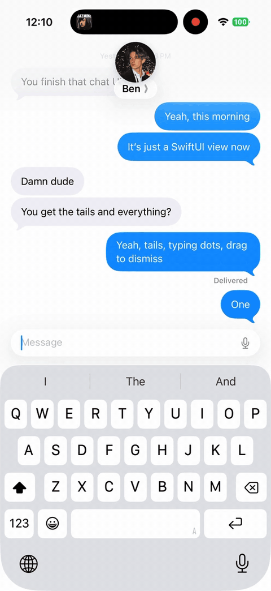

<div align="center">

# Swift Chat

The Messages app, as a SwiftUI view.

[Try it on your phone](https://testflight.apple.com/join/57bKq9jd) · [unionst.com/swiftchat](https://unionst.com/swiftchat) · [Documentation](https://www.swiftipedia.org/documentation/unionchat) · [llms.txt](https://unionst.com/swiftchat/llms.txt) · by [Union St](https://unionst.com)



</div>

Swift Chat is a drop-in SwiftUI chat UI for iOS, for messaging apps and for ChatGPT-style AI assistants. Hand it your messages and it renders them the way Messages does: bubble tails that land on the last message in a run, typing dots, delivery and read receipts, photo and file attachments, a keyboard that follows your finger, and a scroll with real weight to it. A UIKit collection view does the work underneath. SwiftUI is the only API you touch.

Building an AI chat app? One modifier, `.chatStyle(.assistant)`, turns the same view into the layout Siri and ChatGPT use: your question rises to the top and the reply streams in beneath it as Markdown. See the [assistant style](https://unionst.com/swiftchat/assistant) and the [starter app that streams Claude](https://github.com/unionst/swift-chat-ai-starter).

[Installation](#installation) · [Quick start](#quick-start) · [Example app](#example-app) · [Apps using Swift Chat](#apps-using-swift-chat) · [Guides](#guides)

## What’s built in

- **Bubbles** with automatic tail placement, grouping by sender, and timestamp separators.
- **Typing indicators** for one person or a crowd.
- **Delivery states**: sending, sent, delivered, read, failed.
- **Attachments**: photos with BlurHash placeholders, several photos as one collage, and files.
- **Tapbacks**: reactions drawn on the bubble and picked from the long-press menu.
- **Replies**: swipe a message to reply, the original quoted above the answer, a “1 Reply” count under it, and the thread over the blurred conversation, the way Messages does it.
- **The input bar**: text, dictation, a plus menu for photos and files that opens over the keyboard, and an async send hook.
- **Keyboard handling**: interactive dismissal and safe-area management that matches Messages.
- **Group chats**: avatars and sender names appear on their own once three people are in the thread.
- **Pagination**: load older messages at the top with a built-in spinner.
- **Context menus and taps** delivered through UIKit’s own event path, so they always fire.
- **Haptics** on incoming messages, a scroll-to-bottom button, an empty state, and custom headers.
- **An assistant style** for AI threads: your question rises to the top and the answer streams in beneath it as bare text.
- **Dark mode, Dynamic Type, and the iOS 26 glass look**, because it is built from the system’s own materials.

## Requirements

- iOS 18 or later
- On the Mac, a Mac Catalyst app on macOS 26 or later. See [On the Mac](Documentation/mac.md).
- Xcode 26.1 or later. The binary’s module interface is built with Swift 6.2, and an older compiler cannot read it.

## Installation

In Xcode choose File › Add Package Dependencies and paste:

```
https://github.com/unionst/swift-chat.git
```

Or add it to `Package.swift`:

```swift
dependencies: [
    .package(url: "https://github.com/unionst/swift-chat.git", from: "1.0.0")
],
targets: [
    .target(
        name: "MyApp",
        dependencies: [
            .product(name: "SwiftChat", package: "swift-chat")
        ]
    )
]
```

Swift Chat has no package dependencies of its own. The binary carries everything it needs, so there is nothing else to add, link, or embed.

## Quick start

```swift
import SwiftUI
import SwiftChat

struct ConversationView: View {
    @State private var conversation = Conversation()

    var body: some View {
        Chat(conversation.messages) { message in
            Message(message.text, role: message.role, timestamp: message.sentAt)
                .messageStatus(message.status)
        }
        .chatTypingIndicators(conversation.typing)
        .chatInputPlaceholder("iMessage")
        .chatInputCapabilities([.photoLibrary, .files])
        .onChatSend { text, media in
            await conversation.send(text, media)
        }
    }
}

@MainActor @Observable
final class Conversation {
    var messages: [ChatMessage] = []
    var typing: [ChatRole] = []

    func send(_ text: String?, _ media: [MessageMedia]) async {
        let message = ChatMessage(text: text ?? "", role: .me, sentAt: .now, status: .sending)
        messages.append(message)
        await api.deliver(message, attachments: media)
    }
}

struct ChatMessage: Identifiable {
    let id = UUID()
    var text: String
    var role: ChatRole
    var sentAt: Date
    var status: ChatDeliveryStatus?
}
```

`Chat` accepts any `RandomAccessCollection` of `Identifiable` values plus a closure that turns each one into a `Message`. Your model stays yours; nothing has to conform to a protocol.

### Declarative form

Messages can also be written out directly, with the same conditionals and loops you use in SwiftUI:

```swift
Chat {
    Message("Welcome to support", role: .system, timestamp: .now)

    ForEach(messages) { message in
        Message(message.text, role: message.role, timestamp: message.sentAt)
    }

    if showHint {
        Message("Ask anything.", role: .user(id: "bot", displayName: "Assistant"), timestamp: .now)
    }
}
```

### Identity

Every row is keyed by a `Message.id`. In the collection form above, and inside a `ForEach`, that id is your element’s own `id`, so it stays stable as long as your model’s does. A `Message` written out bare in the declarative form gets a fresh identity on every render; set its `id` yourself when you rebuild it across renders and want the row to keep its place, its height, and its delivery label.

### Roles

| Role | Rendered as |
|---|---|
| `.me` | Outgoing bubble on the right |
| `.user(id:displayName:)` | Incoming bubble on the left, with avatar and name in group chats |
| `.system` | Centered gray text with no bubble |

## Example app

[Try it on your phone](https://testflight.apple.com/join/57bKq9jd) through TestFlight, no Xcode needed. It is [Examples/SwiftChatDemo](https://github.com/unionst/swift-chat/tree/main/Examples/SwiftChatDemo), a runnable app with seven screens: a conversation with delivery receipts and typing dots, a group chat, a long thread that loads older messages, attachments, custom colors, an empty state, and an assistant thread in the assistant style. To run it yourself, clone this repository, open `Examples/SwiftChatDemo/SwiftChatDemo.xcodeproj`, and run.

## Apps using Swift Chat

| Rate.fm | Tally | Jester |
|:-:|:-:|:-:|
|  |  |  |
| Group chat with tapbacks on glass | The coach chat, with replies as custom attachment views | An AI conversation, streamed in line by line |

- [Rate.fm](https://apps.apple.com/us/app/rate-fm-rate-your-music/id6756295934): a diary of every album you listen to, where friends send each other records in a message.
- [Tally](https://apps.apple.com/us/app/tally-calorie-lift-coach/id6808934757): a calorie and training journal you keep by texting a coach.
- [Jester](https://apps.apple.com/us/app/jester-ai-rizz-keyboard/id6759629485): an AI dating coach you text for what to say next.
<!--
Add your app on a new line directly above this comment, in the same form:
- [Name](link): what it is, in a sentence.
The link goes to the App Store, a public TestFlight invitation, or the app’s site.
-->

Shipping Swift Chat in your app? Put it on this list with a pull request:

1. [Edit this README](https://github.com/unionst/swift-chat/edit/main/README.md). GitHub makes the fork for you.
2. Add one line at the end of the list: `- [Name](link): what it is, in a sentence.`
3. Open the pull request and say which screen of the app is Swift Chat. Attach a short screen recording of it if you have one, and it can join the row above.

Any app people can get today belongs here, whatever its size: on the App Store, behind a public TestFlight link, or on its own site.

## Guides

The quick start above is enough for a working conversation. Each of these covers one part of the API in full:

- [Messages](Documentation/messages.md): message modifiers, attachments, tapbacks and the long-press menu, replies.
- [Chat modifiers](Documentation/chat-modifiers.md): every modifier on `Chat`, grouped into the input bar, the transcript, taps and menus, and appearance.
- [Loading older messages](Documentation/loading-older-messages.md): pagination and its spinner.
- [Opening on a message](Documentation/opening-on-a-message.md): start a thread on the first unread message instead of the last one.
- [Headers](Documentation/headers.md): your own header, the built-in `ChatHeader`, and group avatars.
- [Assistant style](Documentation/assistant-style.md): the layout for AI threads, with Markdown replies, streaming, and a status line.
- [Folded phones](Documentation/folded-phones.md): the side column and split view on iPhone Duo.
- [On the Mac](Documentation/mac.md): Mac Catalyst, Return to send, and a readable width.
- [Keeping the main thread free](Documentation/main-thread.md): what to keep out of your callbacks, and a watchdog that tells you when it slips.
- [UI testing](Documentation/ui-testing.md): accessibility identifiers for the input bar.

## For AI coding agents

Swift Chat ships an agent skill. Install it into Claude Code, Cursor, Codex, or any client that reads the open skills format:

```
npx skills add unionst/swift-chat
```

That gives your agent the full API, the assistant-style pattern, and the mistakes to avoid, so “add a chat screen with Swift Chat” works in one prompt. There is also an [llms.txt](https://unionst.com/swiftchat/llms.txt) and a [full reference](https://unionst.com/swiftchat/llms-full.txt) if you’d rather paste a link:

```
Add Swift Chat to this iOS app. Package URL https://github.com/unionst/swift-chat.git,
product "SwiftChat", iOS 18+. Read https://unionst.com/swiftchat/llms-full.txt first, then build the
conversation screen with Chat(messages) { Message($0.text, role: $0.role, timestamp: $0.sentAt) }
and wire sending with .onChatSend.
```

## Migrating from UnionChat

Swift Chat was previously published as UnionChat. The package keeps a `UnionChat` product, so `import UnionChat` still compiles; the old repository URL redirects here. New code should depend on the `SwiftChat` product and `import SwiftChat`. No types were renamed.

## License

Swift Chat is free to use in any app, including commercial ones, and ships as a closed-source binary the same way Apple distributes its own frameworks. See [LICENSE](LICENSE) for the short version of what that means. Teams that want source access or custom terms can write to [hello@unionst.com](mailto:hello@unionst.com).

<div align="center">

Made by [Union St](https://unionst.com)

</div>
