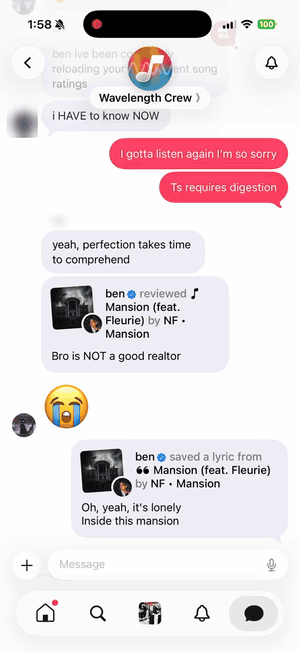
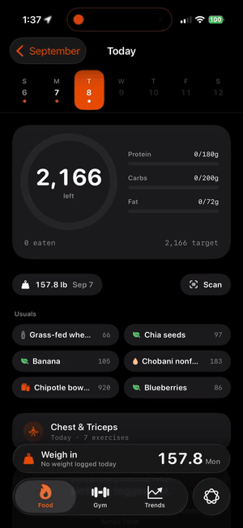
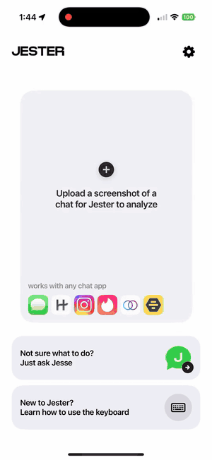

<div align="center">

# Swift Chat

The Messages app, as a SwiftUI view.

[Try it on your phone](https://testflight.apple.com/join/57bKq9jd) · [unionst.com/swiftchat](https://unionst.com/swiftchat) · [Documentation](https://www.swiftipedia.org/documentation/unionchat) · [llms.txt](https://unionst.com/swiftchat/llms.txt) · by [Union St](https://unionst.com)


</div>

Swift Chat is a drop-in SwiftUI chat UI for iOS, for messaging apps and for ChatGPT-style AI assistants. Hand it your messages and it renders them the way Messages does: bubble tails that land on the last message in a run, typing dots, delivery and read receipts, photo and file attachments, a keyboard that follows your finger, and a scroll with real weight to it. A UIKit collection view does the work underneath. SwiftUI is the only API you touch.

Building an AI chat app? One modifier, `.chatStyle(.assistant)`, turns the same view into the layout Siri and ChatGPT use: your question rises to the top and the reply streams in beneath it as Markdown. See the [assistant style](https://unionst.com/swiftchat/assistant) and the [starter app that streams Claude](https://github.com/unionst/swift-chat-ai-starter).

**Get started:** [Installation](#installation) · [Quick start](#quick-start) · [Example app](#example-app) · [Apps using Swift Chat](#apps-using-swift-chat)

**Reference:** [Messages](#messages) · [Chat modifiers](#chat-modifiers) · [Loading older messages](#loading-older-messages) · [Opening on a message](#opening-on-a-message) · [Headers](#headers) · [Assistant style](#assistant-style) · [Folded phones](#folded-phones) · [On the Mac](#on-the-mac) · [Keeping the main thread free](#keeping-the-main-thread-free) · [UI testing](#ui-testing) · [For AI coding agents](#for-ai-coding-agents)

## What’s built in

- **Bubbles** with automatic tail placement, grouping by sender, and timestamp separators.
- **Typing indicators** for one person or a crowd.
- **Delivery states**: sending, sent, delivered, read, failed.
- **Attachments**: photos with BlurHash placeholders, several photos as one collage, and files.
- **Tapbacks**: reactions drawn on the bubble and picked from the long-press menu.
- **Replies**: swipe a message to reply, the original quoted above the answer, a “1 Reply” count under it, and the thread over the blurred conversation, the way Messages does it.
- **The input bar**: text, dictation, a plus menu for photos and files that opens over the keyboard, and an async send hook.
- **Keyboard handling**: interactive dismissal and safe-area management that matches Messages.
- **Group chats**: avatars and sender names appear on their own once three people are in the thread.
- **Pagination**: load older messages at the top with a built-in spinner.
- **Context menus and taps** delivered through UIKit’s own event path, so they always fire.
- **Haptics** on incoming messages, a scroll-to-bottom button, an empty state, and custom headers.
- **An assistant style** for AI threads: your question rises to the top and the answer streams in beneath it as bare text.
- **Dark mode, Dynamic Type, and the iOS 26 glass look**, because it is built from the system’s own materials.

## Requirements

- iOS 18 or later
- On the Mac, a Mac Catalyst app on macOS 26 or later. See [On the Mac](#on-the-mac).
- Xcode 26.1 or later. The binary’s module interface is built with Swift 6.2, and an older compiler cannot read it.

## Installation

In Xcode choose File › Add Package Dependencies and paste:

```
https://github.com/unionst/swift-chat.git
```

Or add it to `Package.swift`:

```swift
dependencies: [
    .package(url: "https://github.com/unionst/swift-chat.git", from: "1.0.0")
],
targets: [
    .target(
        name: "MyApp",
        dependencies: [
            .product(name: "SwiftChat", package: "swift-chat")
        ]
    )
]
```

Swift Chat has no package dependencies of its own. The binary carries everything it needs, so there is nothing else to add, link, or embed.

## Quick start

```swift
import SwiftUI
import SwiftChat

struct ConversationView: View {
    @State private var conversation = Conversation()

    var body: some View {
        Chat(conversation.messages) { message in
            Message(message.text, role: message.role, timestamp: message.sentAt)
                .messageStatus(message.status)
        }
        .chatTypingIndicators(conversation.typing)
        .chatInputPlaceholder("iMessage")
        .chatInputCapabilities([.photoLibrary, .files])
        .onChatSend { text, media in
            await conversation.send(text, media)
        }
    }
}

@MainActor @Observable
final class Conversation {
    var messages: [ChatMessage] = []
    var typing: [ChatRole] = []

    func send(_ text: String?, _ media: [MessageMedia]) async {
        let message = ChatMessage(text: text ?? "", role: .me, sentAt: .now, status: .sending)
        messages.append(message)
        await api.deliver(message, attachments: media)
    }
}

struct ChatMessage: Identifiable {
    let id = UUID()
    var text: String
    var role: ChatRole
    var sentAt: Date
    var status: ChatDeliveryStatus?
}
```

`Chat` accepts any `RandomAccessCollection` of `Identifiable` values plus a closure that turns each one into a `Message`. Your model stays yours; nothing has to conform to a protocol.

### Declarative form

Messages can also be written out directly, with the same conditionals and loops you use in SwiftUI:

```swift
Chat {
    Message("Welcome to support", role: .system, timestamp: .now)

    ForEach(messages) { message in
        Message(message.text, role: message.role, timestamp: message.sentAt)
    }

    if showHint {
        Message("Ask anything.", role: .user(id: "bot", displayName: "Assistant"), timestamp: .now)
    }
}
```

### Identity

Every row is keyed by a `Message.id`. In the collection form above, and inside a `ForEach`, that id is your element’s own `id`, so it stays stable as long as your model’s does. A `Message` written out bare in the declarative form gets a fresh identity on every render; set its `id` yourself when you rebuild it across renders and want the row to keep its place, its height, and its delivery label.

### Roles

| Role | Rendered as |
|---|---|
| `.me` | Outgoing bubble on the right |
| `.user(id:displayName:)` | Incoming bubble on the left, with avatar and name in group chats |
| `.system` | Centered gray text with no bubble |

## Example app

[Try it on your phone](https://testflight.apple.com/join/57bKq9jd) through TestFlight, no Xcode needed. It is [Examples/SwiftChatDemo](https://github.com/unionst/swift-chat/tree/main/Examples/SwiftChatDemo), a runnable app with seven screens: a conversation with delivery receipts and typing dots, a group chat, a long thread that loads older messages, attachments, custom colors, an empty state, and an assistant thread in the assistant style. To run it yourself, clone this repository, open `Examples/SwiftChatDemo/SwiftChatDemo.xcodeproj`, and run.

## Apps using Swift Chat

| Rate.fm | Tally | Jester |
|:-:|:-:|:-:|
|  |  |  |
| Group chat with tapbacks on glass | The coach chat, with replies as custom attachment views | An AI conversation, streamed in line by line |

- [Rate.fm](https://apps.apple.com/us/app/rate-fm-rate-your-music/id6756295934): a diary of every album you listen to, where friends send each other records in a message.
- [Tally](https://apps.apple.com/us/app/tally-calorie-lift-coach/id6808934757): a calorie and training journal you keep by texting a coach.
- [Jester](https://apps.apple.com/us/app/jester-ai-rizz-keyboard/id6759629485): an AI dating coach you text for what to say next.
<!--
Add your app on a new line directly above this comment, in the same form:
- [Name](link): what it is, in a sentence.
The link goes to the App Store, a public TestFlight invitation, or the app’s site.
-->

Shipping Swift Chat in your app? Put it on this list with a pull request:

1. [Edit this README](https://github.com/unionst/swift-chat/edit/main/README.md). GitHub makes the fork for you.
2. Add one line at the end of the list: `- [Name](link): what it is, in a sentence.`
3. Open the pull request and say which screen of the app is Swift Chat. Attach a short screen recording of it if you have one, and it can join the row above.

Any app people can get today belongs here, whatever its size: on the App Store, behind a public TestFlight link, or on its own site.

## Messages

Every `Message` takes text, a role, and a timestamp. Modifiers add the rest:

```swift
Message(message.text, role: message.role, timestamp: message.sentAt)
    .messageStatus(.read)
    .messageMedia(.image(url: photoURL, width: 1200, height: 800, blurhash: "LEHV6nWB2yk8pyo0adR*.7kCMdnj"))
    .messageHeader { Text("Alex").font(.caption) }
    .messageFooter { Text("Edited").font(.caption2) }
    .messageAvatar { AvatarView(user: message.sender) }
    .messageStyle(.plain)
    .contextMenu {
        Button("Copy") { copy(message) }
    }
```

| Modifier | What it does |
|---|---|
| `messageStatus(_:)` | Shows sending, sent, delivered, read, or failed under the bubble |
| `messageMedia(_:)` | Attaches a photo, several photos as one collage, or a file |
| `messageReactions(_:)` | Draws tapbacks on the bubble |
| `messageReply(to:quote:)` | Draws the message as a reply to another. See [Replies](#replies). |
| `messageAttachment { }` | Renders a custom SwiftUI view as the attachment |
| `messageHeader { }` | A view above the bubble, such as a sender name |
| `messageFooter { }` | A view below the bubble |
| `messageAvatar { }` | A custom avatar for incoming messages |
| `messageStyle(_:)` | `.default` for bubbles, `.plain` for bare text |
| `font(_:)` | Overrides the bubble text font |
| `contextMenu { }` | A long-press menu for that message |
| `contentVersion(_:)` | Forces a re-render when content changes but the id does not |

### Attachments

```swift
MessageMedia.image(url: URL, width: Int? = nil, height: Int? = nil, blurhash: String? = nil)
MessageMedia.file(url: URL, name: String, size: Int64? = nil, mimeType: String? = nil)
```

**Photos.** Hand `messageMedia(_:)` an array of images and they are drawn as one collage. Pass width and height to get correctly sized placeholders with no layout shift, and a BlurHash to show a blurred preview while the image loads. `image(url:)` takes `https:`, `file:`, and `data:` URLs. A `data:` URL is decoded in place, so an inline base64 photo renders and opens full screen like any other; network images are cached on disk, local files are read directly.

**Files.** A file is drawn as a bubble the way Messages draws one: its Quick Look thumbnail, its name, and its kind and size. Tapping it opens the file in Quick Look, downloaded first when the URL is remote; add `onChatFileTap { id, file in }` to handle the tap yourself, for example when the file needs your own authorization or download.

**Everything else.** `MessageMedia` also declares `video`, `audio`, `location`, and `poll`. The transcript does not draw those yet; a picked video shows in the input strip and reaches `onChatSend`, and the host draws it in the thread with `messageAttachment { }`.

### Tapbacks and the long-press menu

```swift
Chat(conversation.messages) { message in
    Message(message.text, role: message.role, timestamp: message.sentAt)
        .messageReactions(message.reactions)
}
.chatMessageContextMenu { (id: ChatMessage.ID) in
    ChatContextMenuItem.tapbacks(conversation.reactions(on: id)) { emoji in
        conversation.toggleReaction(emoji, on: id)
    }
    Divider()
    ChatContextMenuItem("Copy", systemImage: "doc.on.doc") {
        UIPasteboard.general.string = conversation.text(of: id)
    }
    if conversation.isMine(id) {
        ChatContextMenuItem("Delete", systemImage: "trash", destructive: true) {
            conversation.delete(id)
        }
    }
}
```

The menu is a result builder: write items one after another, put `Divider()` between groups, and use `if`, `else`, and `for` the way you would in a view. A closure that returns an array of items still works.

### Replies

```swift
Chat(conversation.messages) { message in
    Message(message.text, role: message.role, timestamp: message.sentAt)
        .messageReply(to: message.replyToID)
}
.onChatSend { text, media in
    await conversation.send(text, media: media)
}
.onChatReply { parentID, text, media in
    await conversation.send(text, media: media, replyTo: parentID as? String)
}
```

`messageReply(to:)` draws a message as a reply: the message it answers sits above it as a small outlined quote, joined by a line, and the original shows “1 Reply” under its bubble. Pass `quote:` too for an original that is not loaded yet.

`onChatReply` turns on the rest. Swipe a message to the right and its thread opens: the original and its replies over the blurred conversation, the field reading “Reply”, the keyboard up. Tapping “1 Reply” opens it without the keyboard, and the close button in the header or a tap on the blur goes back. A send while a thread is open goes to `onChatReply` with the id of the message that started the thread, so a reply to a reply stays in the same thread. Without the handler there is no swipe and no thread.

## Chat modifiers

All of these are ordinary SwiftUI view modifiers applied to `Chat`.

### The input bar

| Modifier | What it does |
|---|---|
| `chatInputPlaceholder(_:)` | Placeholder text in the input field. Default is “Message”. |
| `chatInputCapabilities(_:)` | Which attachments the plus button offers: `.camera`, `.photoLibrary`, `.videoLibrary`, `.files`, or `[]` for text only |
| `chatCameraPresented(_:)` | A binding that opens the camera from the outside, the way the plus menu’s Camera row does |
| `onChatSend { text, media in }` | Async handler called when the user sends. `text` may be nil; `media` is an array and may be empty. |
| `onChatTypingChanged { isTyping in }` | True while the field holds text, false once it is sent or cleared |
| `onChatInputTextChanged { text in }` | Fires with the input field’s text on every change |

- **Videos.** Add `.videoLibrary` beside `.photoLibrary` and videos join the Photos sheet, arriving in `onChatSend` as `.video(url:thumbnailURL:duration:)` with a local file URL.
- **Opening the camera yourself.** Set the `chatCameraPresented` binding to `true` and the bar brings the camera up, then puts it back to `false` when the camera closes. It needs `.camera` in `chatInputCapabilities`. A host uses it to land in a thread with the camera already up, say from a lock screen Control.
- **Typing.** A draft left sitting in the field is still typing, so an assistant can hold its reply until the field is clear. `onChatTypingChanged(idleAfter:)` is the keystroke form for the indicator another person sees: true on an edit, false after `idleAfter` without one.
- **Drafts.** Use `onChatInputTextChanged` to keep a draft per thread and seed it back with `chatInitialInputText`.

### The transcript

| Modifier | What it does |
|---|---|
| `chatTypingIndicators(_:)` | Shows typing dots for the given `[ChatRole]` |
| `chatHeader { }` | A SwiftUI view pinned above the transcript. See [Headers](#headers). |
| `chatEmptyView { }` | What to show when there are no messages. Laid out at the transcript’s width, so text wraps. |
| `chatSenderInfo(_:)` | `.automatic` shows avatars and names in group chats only; `.always` shows them everywhere |
| `chatAutoscrollBehavior(_:)` | `.whenAtBottom` (default), `.always`, or `.never`. A scroll-to-bottom button appears when needed. |
| `chatLoadsOlderMessages { }` | Async loader called at the top of the transcript. Return `false` when nothing older remains. See [Loading older messages](#loading-older-messages). |
| `chatHasOlderMessages(_:)` | Whether anything older exists, when you know. `false` draws no spinner, `true` keeps it waiting, `nil` leaves it to the loader’s answer. |
| `chatInitialScrollTarget(id:anchor:onResult:)` | Opens the transcript on a message instead of on the latest one, and keeps it there while history fills in around it. See [Opening on a message](#opening-on-a-message). |
| `onChatScrollEdge(_:perform:)` | Callback when the reader reaches the top or bottom edge |
| `onMessagesEvictable { ids in }` | Tells you which off-screen message ids can be dropped in very long threads |

### Taps and menus

| Modifier | What it does |
|---|---|
| `chatMessageContextMenu { id in … }` | The long-press menu per message, written as a result builder of `ChatContextMenuItem`s with `Divider()` between groups. See [Tapbacks and the long-press menu](#tapbacks-and-the-long-press-menu). |
| `onChatMessageTap { id in }` | Tap handler per message |
| `onChatFileTap { id, file in }` | Tap handler for a file bubble, with the message id and the exact `.file` tapped. Without it a tap opens the file in Quick Look. |
| `onChatReply { parentID, text, media in }` | Turns on swipe to reply and threads, and receives a send made inside a thread. See [Replies](#replies). |

### Appearance

| Modifier | What it does |
|---|---|
| `chatStyle(_:)` | `.messages` (default) or `.assistant`: a sent message rises to the top and the reply streams in beneath it as bare text. See [Assistant style](#assistant-style). |
| `chatTypingStatus(_:)` | A line beside the typing indicator in the assistant style saying what is happening. A new status rolls the old one up and out. |
| `chatBubbleStyle(_:)` | Any `ShapeStyle` for outgoing bubbles. `.tint(_:)` also works. |
| `chatBubbleTailsHidden(_:)` | Hides bubble tails |
| `chatInputBarHeight(_:)` | The message field’s resting height. 40 by default, 46 in the assistant style. |
| `chatInputControlTint(_:)` | The send button’s fill. The accent color by default, the label color in the assistant style. |
| `chatInputBarTint(_:)` | A translucent tint over the input bar’s glass |
| `chatHapticsDisabled(_:)` | Turns off the tap on incoming messages |
| `chatPaginationAnimated(_:)` | Whether bubbles animate during rapid bursts of messages |

### Debugging

| Modifier | What it does |
|---|---|
| `chatMainThreadWatchdog(_:)` | In debug builds, logs a main-thread stall longer than the threshold (100 ms by default) while the field has the keyboard, with the last thing the chat was doing. See [Keeping the main thread free](#keeping-the-main-thread-free). |

## Loading older messages

```swift
Chat(conversation.messages) { message in
    Message(message.text, role: message.role, timestamp: message.sentAt)
}
.chatLoadsOlderMessages {
    await conversation.loadOlderPage()
}
```

Once the thread is tall enough to scroll, the transcript keeps its own spinner above the oldest message; scrolling up finds it already there, reaching it asks for the next page, and the reader’s position holds when the page lands. A thread that fits on screen shows no spinner and asks once on open, so a short cached window still fills and a short thread with nothing older never spins.

The spinner stays until the loader returns `false`, so a thread whose first page already holds everything spins until the reader reaches the top and the loader answers. When your server says whether a page has anything behind it, pass that along and the spinner is drawn only when there is a page to fetch:

```swift
.chatLoadsOlderMessages { await conversation.loadOlderPage() }
.chatHasOlderMessages(conversation.hasOlderMessages)
```

`false` draws nothing above the oldest row and asks the loader for nothing, `true` keeps the spinner there (and clears an earlier `false`, say after a gap in the cache), and `nil` means not known yet, which behaves exactly as it does without the modifier.

## Opening on a message

```swift
Chat(conversation.messages) { message in
    Message(message.text, role: message.role, timestamp: message.sentAt)
}
.chatInitialScrollTarget(id: conversation.latestUnreadID, anchor: .top) { result in
    conversation.finishOpening(result)
}
```

A thread normally opens on its last message. Give `chatInitialScrollTarget` the id of a message, the first unread one or the latest unread reply, and it opens there instead: the transcript stays hidden until that row is laid out, then appears with the message at the anchor. `.top` puts its first line under the header, which is what a long reply wants; `.center` and `.bottom` behave as they do in `ScrollViewReader`. Any message can be the target, a `messageAttachment { }` card included. A message too close to the end of the thread to reach the anchor opens the thread on its last row, as usual.

The id is read once, when the first messages are shown, so pass it together with them. After that the modifier leaves the thread alone: clearing your unread state (the id going to `nil`) or a new id from a later arrival does not scroll anything.

The message does not have to be loaded yet. If it is missing from the first messages, the transcript opens on the latest one and moves to the target when an update brings it, unless the reader has scrolled, tapped the field or sent in the meantime; pass `nil` to stop waiting.

Once positioned, the message keeps its place while a cached snapshot is reconciled with history, older pages land above it, cards change height, or new messages arrive below. The reader scrolling, tapping the field or sending ends that, and the transcript behaves as it always does from there. The `Chat`, its composer and any draft are untouched throughout.

`onResult` is called once: `.positioned` when the transcript is showing the message, `.interrupted` when the reader took over before the message arrived, and `.unreachable` when the message is further back than the transcript keeps loaded (about the newest 350 of the messages you pass), in which case the thread opened on the latest message.

## Headers

`chatHeader { }` pins any SwiftUI view above the transcript:

```swift
Chat(conversation.messages) { message in
    Message(message.text, role: message.role, timestamp: message.sentAt)
}
.chatHeader {
    HStack {
        AvatarView(user: alex)
        VStack(alignment: .leading) {
            Text("Alex").font(.headline)
            Text("Online").font(.caption).foregroundStyle(.green)
        }
    }
}
```

### The built-in header

`ChatHeader` is the header Messages draws: a photo over a name. With a visible navigation bar it sits level with the back button.

```swift
.chatHeader {
    ChatHeader(title: "Alex", avatarURL: alex.photoURL) {
        showProfile = true
    }
}
```

A `subtitle` puts a second line under the name inside the same glass: where someone is, when they were last active, what an assistant is working on. Pass `nil` to take it away. The glass grows and shrinks around it while the header keeps its height, so the transcript never moves.

```swift
.chatHeader {
    ChatHeader(title: "Assistant", subtitle: assistant.currentThought, avatarURL: assistant.photoURL)
}
```

A group wears `ChatGroupAvatar`, which clusters up to seven faces the way Messages does:

```swift
.chatHeader {
    ChatHeader(title: "Team Chat") {
        ChatGroupAvatar(roles: members, size: 60) { role in
            ProfilePhoto(for: role)
        }
    }
}
```

## Assistant style

```swift
Chat(thread.messages, typingUsers: thread.thinking ? [assistant] : []) { message in
    Message(message.text, role: message.role, timestamp: message.sentAt)
}
.chatStyle(.assistant)
.chatTypingStatus(thread.status)
.chatInputPlaceholder("Ask anything")
.onChatSend { text, _ in
    await thread.send(text)
}
```

For a thread with an assistant rather than a person. A sent message rises to the top of the screen instead of settling at the bottom, and the room under it is held open, so the reply streams in beneath it while the question stays put, the way Siri and ChatGPT answer. The transcript does not chase a reply that runs past the bottom of the screen; the reader scrolls to it, and the scroll-to-bottom button appears when something lands below the fold.

**Replies** are drawn as bare text across the full width, with no bubble, tail, or avatar column, and their words fade in one after another as they arrive, the way Siri’s answers do. Reply text is Markdown: headings, bullet and numbered lists, bold and italic, links, block quotes, code blocks, and rules all render as blocks, at 19 points by default; set `.font(_:)` on the `Message` to change it. A photo in a reply runs the full width of the thread and opens full screen on a tap; a `messageAttachment { }` view is drawn bare at full width, so a card you design is the card the reader sees. Long-press on a reply opens the same menu bubbles get.

**Your own messages** keep their bubbles, in gray with dark text rather than the accent color; `chatBubbleStyle(_:)` still recolors them. The message field is taller (`chatInputBarHeight(_:)`) and its send button is `.primary` (`chatInputControlTint(_:)`). A message that sets its own `messageStyle(_:)` keeps that style.

**While the assistant works**, show its typing indicator: in the assistant style it is a small ring spinner. `chatTypingStatus(_:)` puts a line beside it saying what is happening, such as “Searching”, and a new status rolls the old line up and out. Pass `nil` for the spinner alone.

**Stream a reply** by appending one message for it and rewriting that message’s text as tokens arrive. The row grows in place, each new word fades in, and nothing above moves. There is no timestamp separator in the assistant style.

## Folded phones

A folded phone (iPhone Duo, iOS 27.1) moves its status bar and tab bar into a column along one edge, and unfolds into a window wide enough for two columns. The chat reads both layouts itself:

- A tab bar standing in the side column is beside the chat, so the input bar rests at the bottom of the screen instead of holding a tab bar’s room beneath it.
- Unfolded, the chat works as the detail column of a `NavigationSplitView`. The plus menu opens centred on its plus, over the thread it belongs to.
- The photo panel’s grid runs under the side column.

The one thing the host says is where the header starts. With the status bar in the column there is nothing across the top, so the header would sit against the screen’s edge. Give it the room system apps leave there:

```swift
ChatHeaderPlacement.topMargin = hasSideColumn ? 24 : 0
```

`hasSideColumn` is yours to read: `UITraitCollection.verticalBarEdge` is `.leading` or `.trailing` while the column stands. The margin is zero by default, and on a phone with a status bar across the top it should stay zero.

## On the Mac

Swift Chat runs on the Mac as a Mac Catalyst app, from the same package and with the same API. Nothing in your chat code changes.

In a multiplatform target, open the target’s General tab and under Supported Destinations replace **Mac** with **Mac (Mac Catalyst)**. The transcript is built on UIKit, so a native AppKit destination has no build of the package to link; Catalyst is the Mac destination that does.

What the chat does differently on a Mac:

- Return sends, and Shift-Return or Option-Return makes a new line. Return while an input method is composing confirms the composition.
- The transcript follows the window as it is resized, and a thread resting on its last message stays there.

A Mac window can be far wider than a phone, which puts the two sides of a conversation at opposite edges of the screen. Cap how wide the conversation is drawn and it stays centred while the transcript still scrolls across the whole pane:

```swift
ChatLayoutConstants.readableWidth = 720
```

It is `nil` by default, which draws edge to edge. The same line suits an iPad or a split view.

## Keeping the main thread free

A keystroke the main thread is too busy to take is a dropped letter, and a sentence with dropped letters reads as typos. Swift Chat keeps its own work off the keystroke path: a keystroke re-evaluates the input bar alone, not the transcript or your header; the field’s height is measured once per edit; photos and files are decoded, resized, and copied on a background task before they are staged; the transcript diffs its rows only when a message actually changed.

Your side of the chat matters as much, because every callback and view body below runs on the main actor:

- `onChatSend` is async so that you can `await` your network call, but the code before its first `await` runs on the main actor at the moment of the tap. Append the message and return; encode JSON, write files, resize images, and talk to the network on a background task or an actor.
- `onChatInputTextChanged` fires on every keystroke. Store the string and return. Save drafts on a pause or on dismissal, not per keystroke.
- `onChatTypingChanged` fires as the field fills and empties. Send the typing event; do not persist or lay out anything there.
- Row views, the header, and the empty view are re-evaluated when a message changes. Keep their bodies to layout: no date parsing, no image decoding, no file reads, no `Calendar`, `DateFormatter`, or `JSONDecoder` created in a body. Compute once and store on the model.
- Keep message models cheap to compare. The transcript fingerprints each row’s id, role, time, delivery status, text, and reactions on every evaluation; a model whose properties are computed on access pays that cost per row.
- Do not force layout from a callback (`layoutIfNeeded`, reading frames through `UIView` hierarchies) while the keyboard is up.

To see when it slips, apply `.chatMainThreadWatchdog()` in debug builds:

```swift
Chat(messages)
    .chatMainThreadWatchdog(.milliseconds(100))
```

While the field is first responder a probe off the main thread asks it, every 50 ms, to run an empty block. An answer later than the threshold is logged to the unified log (subsystem `com.unionst.swift-chat`, category `MainThread`) with the stall’s length and the last thing the chat was doing (a keystroke, a send, or one of your callbacks) and how long before the stall it began, and is emitted as an Instruments signpost. It is off unless applied, and adds nothing to a release build that leaves it out.

## UI testing

The input bar’s controls carry stable accessibility identifiers:

| Identifier | Control |
|---|---|
| `chat.send` | The trailing button while it sends. Its accessibility label is “Send”. |
| `chat.dictate` | The trailing button while the field is empty and it starts dictation. Its accessibility label is “Dictate”. |
| `chat.attach` | The plus that opens the attachment menu |
| `chat.attach.camera`, `chat.attach.photos`, `chat.attach.files` | The attachment menu’s rows |

## For AI coding agents

Swift Chat ships an agent skill. Install it into Claude Code, Cursor, Codex, or any client that reads the open skills format:

```
npx skills add unionst/swift-chat
```

That gives your agent the full API, the assistant-style pattern, and the mistakes to avoid, so “add a chat screen with Swift Chat” works in one prompt. There is also an [llms.txt](https://unionst.com/swiftchat/llms.txt) and a [full reference](https://unionst.com/swiftchat/llms-full.txt) if you’d rather paste a link:

```
Add Swift Chat to this iOS app. Package URL https://github.com/unionst/swift-chat.git,
product "SwiftChat", iOS 18+. Read https://unionst.com/swiftchat/llms-full.txt first, then build the
conversation screen with Chat(messages) { Message($0.text, role: $0.role, timestamp: $0.sentAt) }
and wire sending with .onChatSend.
```

## Migrating from UnionChat

Swift Chat was previously published as UnionChat. The package keeps a `UnionChat` product, so `import UnionChat` still compiles; the old repository URL redirects here. New code should depend on the `SwiftChat` product and `import SwiftChat`. No types were renamed.

## License

Swift Chat is free to use in any app, including commercial ones, and ships as a closed-source binary the same way Apple distributes its own frameworks. See [LICENSE](LICENSE) for the short version of what that means. Teams that want source access or custom terms can write to [hello@unionst.com](mailto:hello@unionst.com).

<div align="center">

Made by [Union St](https://unionst.com)

</div>
